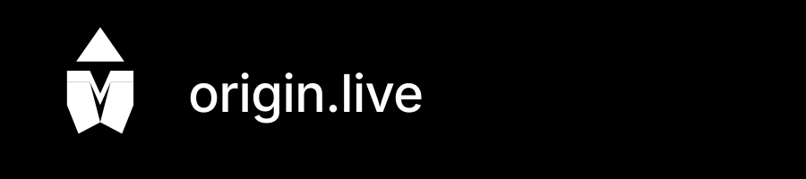
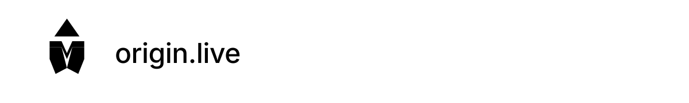

# orgin.live

**Official brand assets and guidelines**

  

---

## Primary Mark

The core identity is a sharp geometric diamond representing origin, centralization, and precision.

  
  &nbsp;&nbsp;&nbsp;
  
  &nbsp;&nbsp;&nbsp;
  

| Variant | File | Best for |
|---------|------|----------|
| Solid | [`logos/icon-solid.svg`](logos/icon-solid.svg) | App icons, favicons, primary use |
| Dark | [`logos/icon-dark.svg`](logos/icon-dark.svg) | Dark backgrounds |
| Outline | [`logos/icon-outline.svg`](logos/icon-outline.svg) | Subtle or line-art contexts |

---

## Lockups

### Horizontal

  

  

### Stacked

  

### Website Header

  

---

## Usage Guidelines

- Prefer the **solid mark** for most applications
- Maintain clear space around the logo equal to at least half the height of the icon
- Do not stretch, distort, rotate, or recolor (use the provided light/dark variants)
- Wordmark uses a clean modern sans-serif (Inter recommended)
- Minimum size: 24px height for the icon mark

## Colors

| Role | Hex |
|------|-----|
| Primary | `#000000` |
| Background | `#FFFFFF` |
| Dark mode | Inverted (white on black) |

All assets are clean, scalable SVGs.

---

  orgin.live — Centralized. Precise. Origin.

