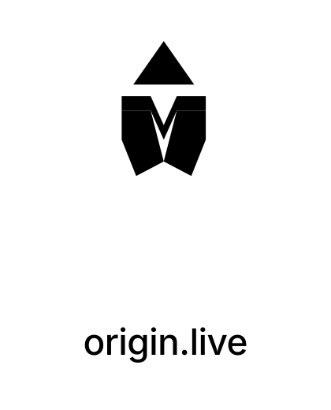

# origin.live

  

  Official brand assets 
  <strong>Centralized · Precise · Origin</strong>

---

## The Mark

A sharp geometric diamond with an inner cutout, side wings, and a split base. It represents origin, centralization, and precision.

  

### Variants

| Solid | Dark | Outline |
|-------|------|---------|
|  |  |  |

Use **solid** on light backgrounds, **dark** on black or near-black, and **outline** when a lighter weight is needed.

## Lockups

### Horizontal

### Stacked

---

## Usage

**Do**
- Keep clear space of at least half the icon height around the mark
- Use the provided files without modification
- Maintain the original proportions

**Don’t**
- Stretch, rotate, recolor, or add shadows/gradients
- Place the mark on busy backgrounds without sufficient contrast
- Scale the icon below 24px height

## Color

| Use | Value |
|-----|-------|
| Primary mark | `#000000` |
| Light background | `#FFFFFF` |
| Dark mode | White mark on `#000000` |

## Downloads

All files are in the [`logos/`](logos) folder as clean SVGs (scalable, preferred for web and print).

- [`icon-solid.svg`](logos/icon-solid.svg)
- [`icon-dark.svg`](logos/icon-dark.svg)
- [`icon-outline.svg`](logos/icon-outline.svg)
- [`horizontal-logo.svg`](logos/horizontal-logo.svg)
- [`stacked-logo.svg`](logos/stacked-logo.svg)

---

  origin.live

